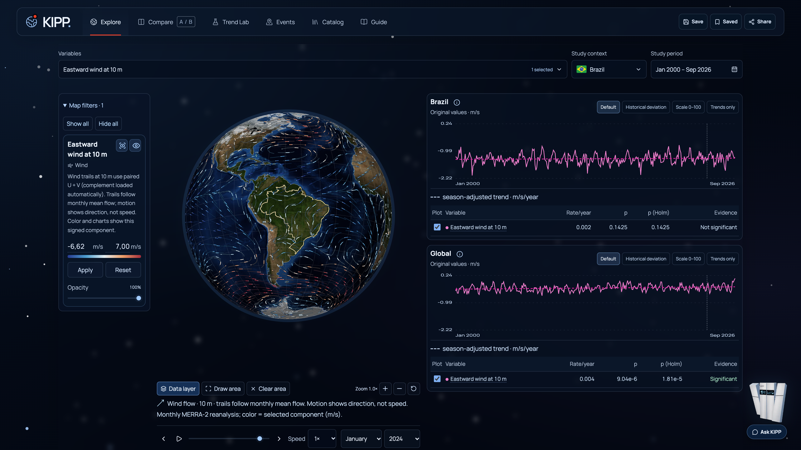
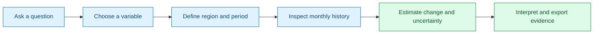
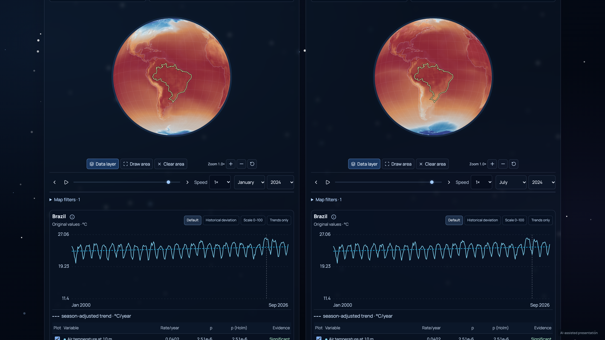
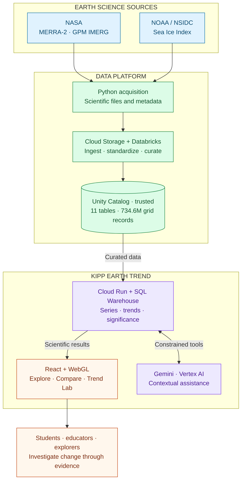
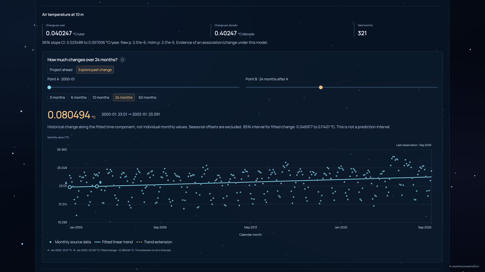

# KIPP · Earth Trend

### Explore a changing Earth through evidence.

An interactive Earth-system investigation lab built by team **KIPP** for 
**NASA Space Apps 2026 · Be An Earth System Trend Detective!**

**[Open the public application](https://kipp-nasa.space)** · **[Watch our demo](https://www.youtube.com/watch?v=hFzB7sUlQuY)** · **[Architecture](docs/architecture.md)** · **[Our data](docs/data-inventory.md)** · **[Documentation](docs/README.md)**

**Try KIPP:** [kipp-nasa.space](https://kipp-nasa.space) — the application is publicly available.

**Watch the project demo:** [KIPP on YouTube](https://www.youtube.com/watch?v=hFzB7sUlQuY).

*The real KIPP interface showing MERRA-2 winds at 10 m, captured locally using public Earth-data responses. The visible robot is AI-generated mascot artwork. [Image provenance and credits](docs/assets/readme/README.md).*

<table>
<tr>
<td align="center"><strong>734.6 million</strong> curated grid records</td>
<td align="center"><strong>224 variables</strong> 106 available in the audited catalog</td>
<td align="center"><strong>11 data tables</strong> curated scientific serving layer</td>
<td align="center"><strong>2000–2026</strong> up to 322 monthly time steps</td>
</tr>
</table>

*Snapshot: 15 November 2026. Counts describe prepared table records, not unique independent observations. [Counting method and full inventory](docs/data-inventory.md).*

**Inside this README:** [Why KIPP](#why-kipp) · [The experience](#one-investigation-six-workspaces) · [NASA data](#the-data-behind-kipp) · [Stack](#our-technology-stack) · [Architecture](#how-kipp-is-built) · [A real investigation](#one-real-investigation) · [Scientific care](#built-for-responsible-interpretation) · [Team and credits](#team-and-credits)

## Why KIPP

Earth-system data can answer meaningful questions about the places we care about. Turning a scientific product into an understandable investigation, however, involves several steps: finding the right variable, understanding its units and coverage, choosing a region, building a time series, and deciding what a change actually means.

**KIPP brings that journey into one visual workspace.** A globe helps people locate patterns. Monthly playback reveals variation through time. Regional series and statistical analysis help them examine the evidence behind those patterns.

Our goal is to make Earth-data investigation approachable while keeping the source, method and limitations visible. KIPP is designed for students, educators and curious explorers who want to move from a question about the planet to a result they can inspect and explain.

### The questions we help people ask

- How has a selected Earth-system variable changed in this region over the available record?
- How does the region's history compare with the global series?
- Is the estimated rate distinguishable from zero under the selected statistical model?
- Do two variables vary together, and how does that association change with a time lag?
- What do the coverage, product type and uncertainty allow us to conclude?

These are educational and exploratory uses. KIPP does not claim measured classroom impact, operational disaster detection or validated forecasting skill.

## From curiosity to evidence

This is the core connection to the challenge: **variable → regional data → time series → rate of change → significance and interpretation**. The map provides spatial context; the investigation follows through to quantitative evidence.

## One investigation, six workspaces

### 01 · Explore — find a place, follow a variable

Explore combines an interactive globe, monthly playback and regional/global charts. Users can select multiple variables, control the visibility of each layer, choose a country bounding region or draw a rectangle, and inspect the history behind the displayed month.

The globe's scientific colors come from the selected monthly field. The Earth background is static NASA Blue Marble imagery. Map color and playback help reveal patterns; the time series provides the numerical context needed to investigate them.

### 02 · Compare — put two views side by side

Compare provides two workspaces for studying different periods or regions, with synchronized cameras and playback controls. Each panel retains its own investigation settings. Shared scales for the same variable support visual comparison.

*This local capture compares January and July 2024 temperature fields over the Brazil bounding region. It illustrates seasonal/spatial comparison; two maps alone do not establish a trend, significance or causation.*

### 03 · Trend Lab — measure change and examine relationships

Trend Lab takes one or two continuous indicators and a study region through three complementary views:

| View | Question | Evidence shown |
| --- | --- | --- |
| **Trend** | How quickly is the variable changing? | Fitted seasonal time component, rate per year/decade, slope uncertainty, valid months and adjusted evidence. |
| **Anomalies** | How does a month differ from its reference? | Raw values, calendar-month departures and standardized departures, with reference-period context. |
| **Relationships** | How do two indicators vary together? | Raw/adjusted associations, scatterplots and lag analysis from 0 to 6 months. |

The same submitted investigation connects these views. JSON and CSV exports retain the request, sources and method metadata so results can be examined beyond the interface. Fitted-change controls describe movement along the model's time component; an extension beyond observed dates is not a forecast.

### 04 · Events — use history as a starting point

Historical presets help users begin with a location and period rather than a blank screen. They provide context for exploring environmental conditions. Monthly fields do not detect the event, measure its damage or establish its cause; unavailable variables and periods remain explicit.

### 05 · Catalog — understand what a variable represents

The Catalog combines educational variable descriptions and ecosystem entry points with the runtime inventory. It helps distinguish related quantities, connect questions to suitable indicators, and open an investigation with a coherent region and period.

A variable being registered does not guarantee current availability. The live catalog exposes the actual coverage and source metadata used by the application.

### 06 · Guide — interpret the result

The Guide supports the investigation with explanations of variables, methods and limitations. It helps users read a trend, distinguish a raw value from an anomaly and understand why significance is conditional on the model and data.

### Ask KIPP — guidance alongside the investigation

The assistant uses **Gemini through Vertex AI** to explain the active context and invoke constrained data/navigation tools. It can help prepare an investigation and discuss returned results while the statistical calculations remain in the scientific API.

The assistant is optional. Users can complete the investigation without a model conversation. AI-generated explanations can be wrong and must be checked against the data, coverage and methods.

## The data behind KIPP

KIPP prepares Earth-science products into monthly fields and curated tables that can be queried together. Source identity, units, data type and coverage remain part of the application contract.

### NASA sources in the active catalog

| Family | Source streams | Role in the project |
| --- | --- | --- |
| **MERRA-2** | Six collections: `M2TMNXSLV`, `M2TMNXFLX`, `M2TMNXCSP`, `M2TMNXAER`, `M2TMNXADG`, `M2TMNXCHM`, version 5.12.4 | Temperature, humidity, winds, pressure, fluxes, clouds, aerosols and chemistry. MERRA-2 is reanalysis; COSP fields are model-simulated satellite diagnostics. |
| **GPM IMERG** | Final and Late V07 processing streams | Monthly precipitation totals/rates in a consolidated chronological series with monthly processing provenance. |
| **NOAA/NSIDC Sea Ice Index** | G02135 v4; counted separately from NASA | Prepared sea-ice fields and their source/coverage context. |

That means **two NASA families and eight NASA collection/processing streams**, plus the NOAA/NSIDC family. These are not eight independent NASA missions. The API has eight product labels because it groups IMERG Final and Late under one label.

The repository also preserves acquisition and processing work for **MODIS**, **GRACE/GRACE-FO** and **NASA COOLR**. Their presence in a pipeline or experiment is not a claim that they are currently selectable application layers.

### What the scale numbers mean

| Measure | Audited scope |
| --- | --- |
| **734,637,888 records** | Sum of grid rows across 11 serving tables, counting each table/month once. Shared variables do not multiply the row count. |
| **224 registered variables** | 106 available and 118 unavailable under the audited coverage configuration. |
| **11 curated tables** | Nine MERRA-2 tables, one IMERG table and one sea-ice table. |
| **321 MERRA-2 months** | January 2000–September 2026. |
| **322 IMERG/sea-ice months** | January 2000–October 2026. Valid coverage still depends on the variable and cell. |
| **207,936 grid rows per monthly table** | 361 latitude rows × 576 longitude columns in the prepared application grid. This is not native satellite resolution. |

The audited catalog reported `databricks-sql`, `trusted` and revision `kipp-earth-api-00043-mev`. These are dated metadata counts, not a storage-size estimate or a count of independent valid measurements. Tables overlap in geography and time.

[Read the complete inventory](docs/data-inventory.md) · [Download table-level metadata](docs/data-inventory-2026-11-15.csv) · [Explore source definitions](docs/fontes-transient-dados.csv)

## Our technology stack

The stack connects scientific data processing, interactive visualization and a protected application API. The marks below identify technologies used in the project; they do not imply sponsorship or endorsement.

<table>
<tr>
<td align="center" width="150"> <strong>React</strong></td>
<td align="center" width="150"> <strong>TypeScript</strong></td>
<td align="center" width="150"> <strong>Vite</strong></td>
<td align="center" width="150"> <strong>WebGL</strong></td>
<td align="center" width="150"> <strong>Node.js</strong></td>
<td align="center" width="150"> <strong>Fastify</strong></td>
</tr>
<tr>
<td align="center" width="150"> <strong>Python</strong></td>
<td align="center" width="150"> <strong>NumPy</strong></td>
<td align="center" width="150"> <strong>pandas</strong></td>
<td align="center" width="150"> <strong>SciPy</strong></td>
<td align="center" width="150"> <strong>Apache Spark</strong></td>
<td align="center" width="150"> <strong>Databricks</strong></td>
</tr>
<tr>
<td align="center" width="150"> <strong>Google Cloud</strong></td>
<td align="center" width="150"> <strong>Gemini</strong></td>
<td align="center" width="150"> <strong>Cloudflare</strong></td>
<td align="center" width="150"> <strong>Vercel</strong></td>
<td align="center" width="150"> <strong>Docker</strong></td>
<td align="center" width="150"> <strong>GitHub Actions</strong></td>
</tr>
</table>

### What each layer contributes

| Layer | Technologies | Responsibility |
| --- | --- | --- |
| **Interactive experience** | React 19, TypeScript, Vite, WebGL, D3 geographic utilities | Globe interaction, layered monthly fields, charts, comparison and study controls. |
| **Scientific acquisition** | Python, earthaccess, xarray, NumPy, pandas, SciPy | Search/download, decode scientific files, preserve missing values and prepare monthly data. |
| **Data engineering** | Cloud Storage, Databricks, PySpark, SQL, Delta tables, Unity Catalog | Stage source files, standardize fields, curate tables and maintain metadata/coverage. |
| **Scientific serving** | Node.js 24, Fastify, Cloud Run, Databricks SQL Warehouse | Validate requests, aggregate regional series and compute trends, anomalies and relationships. |
| **Contextual AI** | Gemini, Vertex AI, Firestore | Bounded assistant tools and persistent usage quotas, separate from statistical computation. |
| **Delivery and operations** | Cloudflare Workers, Vercel, Docker, Artifact Registry, GitHub Actions, Google IAM | Public application hosting, protected backend access and deployment checks. |

Logo assets are stored locally in this repository. [Sources, versions and notices](docs/assets/readme/README.md) accompany them; the README does not depend on a third-party icon CDN.

## How KIPP is built

### From source files to an investigation

**Acquisition.** Python scripts search and decode scientific products, preserving their metadata. Files and sidecars are staged in Google Cloud Storage.

**Curation.** Databricks jobs read the staged files into `transient`, then standardize columns and contracts into `trusted` Delta tables. The coverage inventory controls which variables can be exposed. A configured job is distinct from a successful load.

**Serving and analysis.** The private Cloud Run API queries reviewed tables through SQL Warehouse, returns monthly fields and regional/global series, and computes the active statistical models. Requests have validation, limits, timeouts and bounded caching.

**Exploration.** The browser receives data through same-origin Cloudflare or Vercel proxies. It renders WebGL fields and charts, preserves investigation state, and lets users inspect and export evidence.

Cloudflare and Vercel share the same backend but use different server-side authentication mechanisms. Vercel uses OIDC federation; Cloudflare uses a server-only service identity to obtain a Google ID token. Visitors need no cloud credentials. SQL Warehouse is the sole active scientific provider; preserved Lakebase adapters are inactive.

The diagram follows data/results and service dependencies, not continuous streaming. [The full architecture](docs/architecture.md) includes trust boundaries, ingestion and a Mermaid request sequence.

## One real investigation

**Question:** How did air temperature at 10 m vary across the Brazil bounding region from January 2000 to September 2026?

*Local Trend Lab capture from a two-indicator investigation. Its Holm-adjusted p belongs to that full test family. The table below reports the unadjusted p from the independent public-API check.*

| Study setting | Value |
| --- | --- |
| Variable | Air temperature at 10 m (`temperature`), in °C |
| Source | NASA/GMAO MERRA-2 M2TMNXSLV 5.12.4 — atmospheric reanalysis |
| Region | `[-73.98614, -33.76766, -34.73135, 5.24412]`, west/south/east/north |
| Period | January 2000–September 2026 |
| Sample | 321 monthly values |
| Model | Linear calendar time with calendar-month effects; Newey–West HAC12 inference |
| Estimated rate | **0.040247 °C/year** |
| 95% slope interval | **0.023488 to 0.057006 °C/year** |
| Approximate unadjusted p | **2.51459 × 10⁻⁶** |

The estimated rate is positive under the chosen model, data and period. Independent statsmodels calculations matched the public API's slope, robust standard error and approximate p for both the regional and global series.

The region is a **rectangle**, including land and ocean outside Brazil's exact boundary. The slope interval is not a prediction interval. This example does not identify a cause, forecast future temperature or constitute a peer-reviewed scientific discovery. [Method and reproducibility](docs/runtime-trends.md#verification-and-one-real-data-check) · [Dated verification](docs/repository-audit-2026-11-15.md)

### Revisit the case in KIPP

Open **Trend Lab**, select **Air temperature at 10 m**, choose the Brazil bounding region and the dates above, then generate the investigation. Inspect the original-unit trend and preserve the exported request, source revision and method. For anomalies, also record the reference period; adjusted significance depends on the complete selected test family.

## Built for responsible interpretation

| Design choice | Why it matters |
| --- | --- |
| **Product identity travels with results** | Reanalysis, satellite estimates and model-simulator diagnostics have different meanings. |
| **Coverage is explicit** | Unavailable cells/months remain missing; synthetic values do not replace a failed scientific query. |
| **Seasonal trends use calendar time** | Missing dates are not compressed into adjacent observations; recurring calendar-month effects are modeled. |
| **Uncertainty has a stated method** | HAC12 and approximate normal-Wald inference have assumptions; short/gapped/degenerate samples can suppress inference. |
| **Multiple tests retain their family** | Holm adjustment includes the selected tests, including hidden curves, rather than shrinking when the display changes. |
| **Provenance survives export** | Source, region, period, units and method can accompany an interpretation outside the application. |
| **AI remains a guide** | Generated explanations should be checked against the scientific API; they do not validate a result. |

IMERG Final/Late transitions retain processing provenance and can affect comparisons; the combined record is not described as homogenized. An anomaly reference is not automatically a 30-year climate normal. Resampling does not create resolution, significance does not establish causality, and extrapolating a fitted line does not establish predictive skill.

[Seasonal trends](docs/runtime-trends.md) · [Anomalies and relationships](docs/trend-lab-relationships.md) · [Data contract](docs/contrato-dados-api-frontend.md)

## Designed for learning and further investigation

KIPP's contribution is the connection between **spatial exploration, regional comparison, statistical analysis and contextual guidance**. A user can see a pattern, inspect its history and examine the model's evidence without losing the investigation context.

For students, it offers a path from a visual question to a quantified result. For educators, it provides a starting point for discussing source quality, uncertainty and interpretation. For curious explorers, it makes comparisons across places and periods accessible through the same workflow. These are intended benefits, not measured impact claims.

The regional selection and common data contract support investigating other places where the selected product has valid coverage. Future work can extend scientific review, source availability and study templates; new coverage or predictive capabilities must be demonstrated before being presented as completed features.

## Explore the repository

| Area | What lives here |
| --- | --- |
| [frontend/](frontend/) | Product experience, globe rendering, charts, assistant interface and hosting proxies. |
| [backend/](backend/) | Data API, reviewed source registry, statistical methods and assistant tools. |
| [data/](data/) | Acquisition, decoding, regridding and offline extraction checks. |
| [databricks/](databricks/) | Scientific source contracts, notebooks, standardization, catalogs and job bundles. |
| [docs/](docs/) | Architecture, source inventory, scientific methods and delivery evidence. |
| [context/](context/) · [ml_experiments/](ml_experiments/) | Challenge references and exploratory work, preserved separately from application claims. |

For technical setup and operation, use the [frontend guide](frontend/README.md), [API guide](backend/README.md), [hosting guide](docs/cloudflare-deploy.md) and [backend CI/CD](docs/backend-cicd.md).

## Project evidence and delivery

The [repository review](docs/repository-audit-2026-11-15.md) records public catalog checks, data accounting, independent numerical reproduction and dated automated test/build results. Software checks, scientific review and official submission are separate forms of evidence.

The public application is available at **[kipp-nasa.space](https://kipp-nasa.space/)**, with a **[Vercel mirror](https://kipp-earth-trends-lab.vercel.app/)**. Screenshots in this README were captured locally and are not proof that every local interface revision is deployed.

<strong>Space Apps delivery status</strong>

The project demo is available on **[YouTube](https://www.youtube.com/watch?v=hFzB7sUlQuY)**. The official Project URL, event/timezone confirmation and submission receipt remain pending in the project records. The repository and website do not replace the official Project submission. Final materials, shared services and linked data must follow the confirmed submission freeze.

[Submission narrative and source inventory](docs/submission.md) · [Submission checklist](docs/submission_checklist.md) · [Delivery evidence](docs/space-apps-2026-entrega.md)

## Team and credits

**Built by team KIPP.** The project brings together data engineering, Earth-data exploration, software development and scientific communication. Registered members and individual contributions belong in the final team/submission record; they are not inferred from Git authorship.

We acknowledge NASA/GMAO, GPM and NOAA/NSIDC for the products identified in the source inventory. NASA Blue Marble provides the static Earth imagery; Natural Earth/world-atlas provide map context. The frontend also uses local Manrope and Instrument Serif fonts, Lucide icons and bundled country flags under their applicable terms.

### AI use

- **OpenAI Codex** assisted code, tests, documentation, metadata review and media preparation.
- **OpenAI ImageGen** generated the KIPP mascot artwork. The robot is interpretive artwork inspired by *Interstellar*, not official film art; its screen graphics are decorative. [Mascot credits](docs/kipp-mascot.md).
- **Gemini through Vertex AI** provides the optional in-app assistant.

NASA-derived scientific inputs are not AI-generated observations. Screenshots are captures of the real application. Human review remains necessary for scientific interpretation, attribution and final submission. KIPP does not claim NASA or technology-provider endorsement.

### Sources and reuse

[Scientific products and platform references](docs/submission.md) · [Image and logo attribution](docs/assets/readme/README.md) · [AI and delivery record](docs/space-apps-2026-entrega.md)

The frontend package declares ISC, but a repository-wide code license has not been supplied. Data, logos, fonts, icons and artwork retain their respective terms; the package field does not establish a blanket license for these materials.

---

**KIPP · Earth Trend** 
A question about Earth. A region and a record. Evidence you can examine.

**[Start exploring](https://kipp-nasa.space/)**

