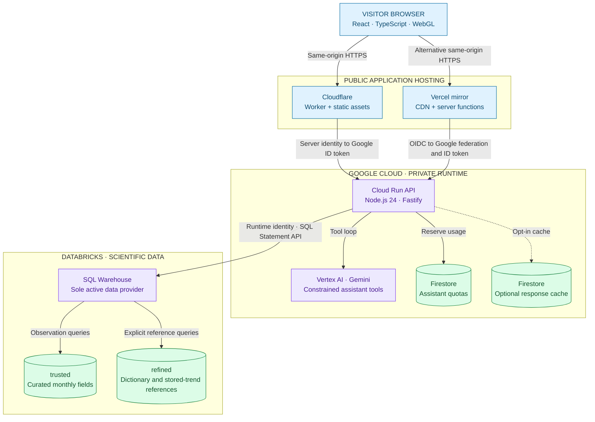
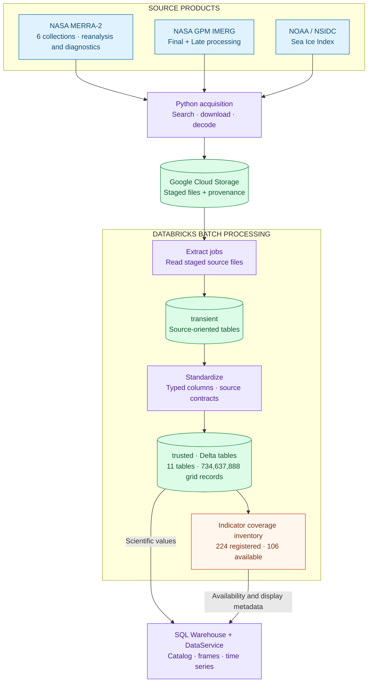
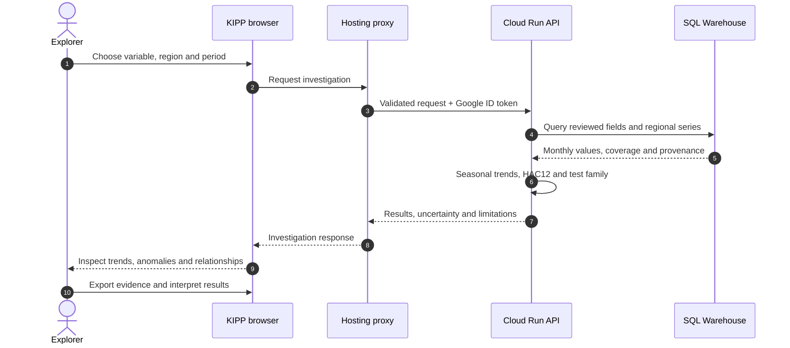

# KIPP architecture

Current implementation reference, reviewed **15 November 2026** against checkout `c49cf35` and the public catalog (revision `kipp-earth-api-00043-mev`). Source-code configuration and live evidence are distinct; this is not an infrastructure or scientific certification.

## Architecture goals and stack

KIPP joins spatial exploration with statistical evidence in one investigation workflow. React/TypeScript/Vite and WebGL provide the interactive experience; Python and Databricks/PySpark prepare scientific products; Delta tables in Unity Catalog preserve the curated data; Node.js 24/Fastify and SQL Warehouse serve and analyze it. Cloudflare/Vercel deliver the application, Cloud Run hosts the API, and Gemini/Vertex AI provides contextual guidance.

The curated serving layer represents **734,637,888 grid records in 11 tables**, with **224 registered variables and 106 available** in the audited catalog. It covers two NASA families through eight collection/processing streams, plus NOAA/NSIDC sea ice. See [source definitions, table counts and scope](data-inventory.md).

## Runtime and trust boundaries

Arrows in this runtime diagram show requests and dependencies; responses travel back along the same paths. Dashed edges mark optional components. Visitors need no cloud credentials. `/api/earth/*` and `/api/assistant` run on the selected host and invoke IAM-protected Cloud Run. The browser renders fields and results; the API queries scientific data and computes the active statistical models.

| Component | Responsibility and code evidence |
| --- | --- |
| Browser | Six workspaces, independent investigation state, monthly fields and chart interaction. [App](../frontend/src/App.tsx), [Trend Lab](../frontend/src/components/TrendLab.tsx). |
| Shared proxy | Fixed upstream, route/parameter allowlists, bounded requests, timeouts and sanitized errors. [Data proxy](../frontend/server/earthProxy.ts), [assistant proxy](../frontend/server/assistantProxy.ts). |
| Cloudflare | Static assets and Node-compatible adapter; server secret `GOOGLE_SERVICE_ACCOUNT_JSON` signs an assertion for a short-lived Google ID token. Public reads can use edge cache. [Worker](../frontend/cloudflare/worker.mjs), [configuration](../frontend/wrangler.jsonc). |
| Vercel | Same proxy contracts; workload OIDC exchanges through Google federation for a service ID token. [Authentication](../frontend/server/cloudRunAuth.ts), [configuration](../frontend/vercel.json). |
| Cloud Run | Validates inputs, serves catalog/frames/series/comparisons/investigations and runs constrained assistant tools. [Server](../backend/src/server.ts). |
| SQL Warehouse | Sole active scientific provider. Only `DATA_PROVIDER=databricks-sql` is accepted; no active Lakebase/hybrid fallback. [Provider](../backend/src/providers/databricks.ts), [data service](../backend/src/data.ts). |
| Assistant | Gemini calls and bounded tools, using runtime Google credentials. Persistent quotas are separate from response caching. [Assistant](../backend/src/assistant.ts), [quotas](../backend/src/assistant-quota.ts). |

Vercel uses federation; Cloudflare currently uses a server-side service-account key. Neither puts credentials in the public bundle. Do not describe both paths as keyless. Quotas limit use but are not individual visitor authentication.

## Acquisition and provenance

This is staged batch processing. Python acquisition is separate from Databricks reading staged objects; the diagram does not assert a continuous scheduler or direct NASA downloads in every job. Deploying a notebook does not prove successful ingestion. See [job operations](databricks-bundle.md), [source inventory](fontes-transient-dados.csv) and [pipeline contract](contrato-pipelines-api.md).

The [runtime registry](../backend/src/registry.ts) defines **224 variables over 11 observation tables**. [Trusted mappings](../backend/src/trusted-map.ts) fix physical columns; `tb_indicator_coverage` controls visibility and reviewed display ranges. The public snapshot had **106 available and 118 unavailable** entries. Registration, ingestion and a completed scientific investigation are different states.

Observation queries read `earth-trend-data.trusted`. Two explicitly allowlisted `refined` references remain for the indicator dictionary and previously stored trends; they are separate from dynamically fitting the selected series. Stored trends retain their own period/method. Lakebase adapters remain inactive.

Responses retain product, table/column, units, data type, coverage and processing notes. MERRA-2 is reanalysis; COSP entries are model-simulated satellite diagnostics. IMERG Final/Late provenance is retained within the consolidated rainfall series. Missing cells/months remain unavailable. Spatial aggregation and valid-area weighting follow each source contract; study regions are bounding boxes, including antimeridian-crossing rectangles.

## From question to evidence

This sequence shows a successful Trend Lab request on a cache miss. Insufficient data remains an explicit result; no generated values fill gaps. AI guidance is optional and is not a prerequisite for the statistical calculation.

## Request and analysis flow

1. Load catalog, configuration and event context through the hosting proxy. Capabilities and availability determine which investigations can run.
2. Request monthly binary/JSON frames. Binary `KIPP` frames carry a JSON header, Float32 values and coverage; the browser creates GPU textures.
3. Request regional/global comparison series and trend metadata. Batches support up to six variables and retain per-variable errors.
4. `/v1/investigation` accepts one or two continuous indicators, bbox, study/reference dates and `method=relationships-v1`. The union of periods is bounded to 600 calendar months.
5. The API computes trends, anomalies and lagged relationships. Evidence exports retain request/source/method metadata. Saved settings are not immutable data snapshots.

The authoritative seasonal method is [runtime-trend.ts](../backend/src/runtime-trend.ts): linear calendar time plus calendar-month effects, Newey–West HAC12, approximate normal-Wald inference and insufficient-data states. Descriptive fits require at least 24 valid values and two of every calendar month; inference requires at least 60 consecutive valid months and nondegenerate residual variation. These are project guards, not universal guarantees.

[ComparisonAnalysis](../frontend/src/components/ComparisonAnalysis.tsx) applies Holm across selected variables and both scopes when a region is selected; hidden curves remain in the family. Trend Lab includes its selected trend tests and seven lag tests in its investigation family. Relationships describe associations, not causal effects. Read baseline dates from the submitted request; an anomaly reference is not automatically a 30-year climate normal. See [trend methods](runtime-trends.md) and [relationship contract](trend-lab-relationships.md).

## Caching and failure behavior

The browser caches public frames/JSON with bounded memory and deduplication. Public reads use ETag/Cache-Control; Cloudflare adds edge caching. Cloud Run has bounded memory caching and an **optional** Firestore cache (`PERSISTENT_CACHE=firestore`), distinct from persistent assistant quotas. See [API operations](../backend/README.md).

Source revisions and request settings form data identity, but an API revision does not freeze mutable upstream tables. Cold starts, unavailable coverage and query-budget limits can produce explicit errors. No simulated fallback substitutes missing scientific data. Assistant failures do not become scientific results.

## Delivery and historical diagrams

Vercel uses `frontend/` as build root and `main` as production branch. Cloudflare has a separate workflow. Backend CI deploys an immutable container image with candidate readiness and post-promotion checks. See [hosting](cloudflare-deploy.md) and [backend CI/CD](backend-cicd.md).

Automatic freeze coverage is incomplete: Cloudflare has an early cutoff check, while the inspected Vercel/backend paths have no equivalent date gate. Confirm the event cutoff, record final versions and protect the shared API/data as well as static links. The [audit](repository-audit-2026-11-15.md) tracks this open delivery risk.

`architecture.html` and `architecture-technical.html` are earlier local visual drafts of hybrid/Lakebase serving. They are historical and must not be used as the current architecture. This reference supersedes their active-provider claims while preserving the drafts.

OpenAI Codex assisted this documentation. Team review remains pending. This review does not publish services or submit the project.
