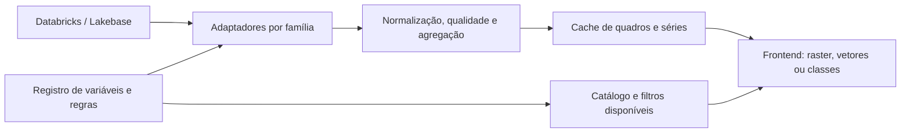

# Contrato de dados entre Databricks, API e frontend

Status: análise dos dados reais e proposta de contrato. As rotas e os campos
`v2` abaixo ainda não estão implementados. A API publicada continua em `v1`.

## Evidência e alcance

Consulta direta ao workspace GCP 8259554586019913, warehouse
74a8d94611137690, catálogo `earth-trend-data.refined`, em 14/11/2026.
O recorte consultado contém 70 tabelas e 540.417.600 linhas, incluindo a tabela
antiga `merra2_ts`. A ingestão continua ativa: esse número descreve o recorte,
não um total permanente.

Foram consultados o schema de todas as tabelas, suas contagens por mês e os
perfis de coordenadas e de cada coluna numérica no primeiro mês disponível de
cada tabela. O perfil de qualidade é amostral no tempo; não certifica todos os
meses. A documentação YAML foi cruzada com os comentários das colunas no
Databricks. Não foram usados arquivos `kipp/serving`.

O inventário completo por tabela está em
[inventario-api-databricks.csv](inventario-api-databricks.csv).
O contrato de normalização que o time de pipelines deve entregar está em
[contrato-pipelines-api.md](contrato-pipelines-api.md). Preferir normalização
na camada Gold; as conversões nos adaptadores descritas aqui também permitem
a transição enquanto essa entrega não existe, sem aplicá-las duas vezes.

A unicidade de `(lat,lon,time)` foi confirmada no primeiro mês disponível de
cada uma das 70 tabelas. A verificação não cobre todo o histórico.

## O que é comum

Todas as tabelas têm `lat` DOUBLE, `lon` DOUBLE e `time` TIMESTAMP. Todas as
séries observadas são mensais. Não foram encontrados meses ausentes entre o
primeiro e o último mês de cada tabela, nem timestamps nulos na contagem mensal.
Isso não significa que todo pixel tenha dados válidos em todos os meses.

Na amostra espacial, 69 tabelas têm 361 latitudes e 576 longitudes, totalizando
207.936 posições por mês. MOD13C2 tem 3.600 × 7.200 = 25.920.000 posições por
mês. Não foram encontradas coordenadas nulas ou fora dos limites geográficos
nessas amostras.

MERRA-2 usa, por exemplo, `2024-01-01T00:30:00Z`; outros produtos usam
`2024-01-01T00:00:00Z`. O identificador temporal comum deve ser `2024-01`, com
limites do período explícitos e UTC. Não cruzar fontes por igualdade do timestamp
bruto ou por um horário local do navegador.

| Filtro público | Aplicação | Regra da API |
|---|---|---|
| Tema e variável | Seleção do catálogo | IDs físicos estáveis, sem nomes de tabelas |
| Mês | Quadro no globo | `YYYY-MM`, disponibilidade da seleção exata |
| Início e fim | Série temporal | Meses inclusivos, sem preencher lacunas com zero |
| Região | Todos os produtos | `bbox` ou ID de região conhecido; antimeridiano suportado |
| Qualidade | Contrato comum, regras próprias | Perfis publicados por variável e versionados |
| Detalhe | Todos os quadros | Automático pelo viewport e orçamento de células |

Tema organiza o catálogo, mas não entra no predicado SQL. Uma região nomeada
resolvida para bbox deve continuar identificada como bbox, não como uma análise
do polígono exato de uma bacia, país ou bioma.

Os filtros condicionais são altura/nível de pressão, definição da tropopausa,
estatística, hemisfério e produto/processamento. A API deve publicar combinações
válidas, evitando um produto cartesiano de opções que não existem.

## Famílias e suas regras

| Família | O que chega ao frontend | Tratamento obrigatório na API |
|---|---|---|
| Temperaturas MERRA-2 | Escalar em °C | Converter K; distinguir ar, superfície, nuvens, ponto de orvalho e bulbo úmido |
| Pressões | Escalar em hPa | Converter Pa; distinguir superfície, nível do mar, nuvens, camada limite e tropopausa |
| Altura geopotencial/deslocamento | Escalar em m | Preservar referência e nível; valores negativos podem ser válidos |
| Umidade específica | Escalar em g/kg | Converter kg/kg; não apresentar como umidade relativa em % |
| Colunas de vapor, água, gelo e ozônio | Escalar na unidade física declarada | Não unir ozônio em Dobson com massa de ozônio sem transformação validada |
| Movimento vertical OMEGA500 | Escalar assinado em Pa/s | Não representar como vento horizontal ou velocidade vertical em m/s |
| Variâncias `Var_*` | Escalar com unidade ao quadrado | Não tratar como média, erro de medição ou anomalia climatológica |
| Vento U/V | Campo vetorial em m/s | Unir componentes no mesmo mês/nível/grade, com máscara conjunta |
| Precipitação | Total mensal em mm ou taxa em mm/h | Manter Final/Late separados e a semântica de total/taxa |
| Probabilidade de fase líquida | Escalar em %, domínio 0–100 | Não confundir com probabilidade de chover; zero é válido |
| NDVI/EVI | Dois escalares adimensionais distintos | Usar campos calibrados, aplicar QA e agregar a grade de 0,05° |
| GRACE | Anomalia de massa em mm de água equivalente | Informar referência 2004–2009; não rotular como água subterrânea |
| Massa GRACE por célula | Métrica extensiva em Gt | Agregação espacial por soma; não usar o agregador de médias |
| Máscara de gelo marinho | Classes oceano/gelo | Preservar 0/1 e ausência; não converter média de flags em concentração física |
| Concentração de gelo | Escalar em %, domínio 0–100 | Manter cobertura e método de reamostragem próprios do produto |

`PBLTOP` é pressão no topo da camada limite, não altura em metros. As diferentes
definições de pressão da tropopausa também não são níveis intercambiáveis.

Para vento, calcular `sqrt(mean(U)^2 + mean(V)^2)` fornece o módulo do vetor médio.
Isso não equivale à média das velocidades instantâneas. Agregar U e V primeiro;
não tirar média aritmética de ângulos. A direção deve declarar sua convenção
(sentido do vetor ou direção meteorológica de origem).

Conversões de variância usam o quadrado do fator de escala. A variância em K²
mantém o valor numérico em °C²; não se subtrai 273,15. Uma média espacial de
variâncias pode ser exibida com esse nome, mas não representa automaticamente a
variância da média regional. Na amostra, `Var_DISPH` apresentou mínimo de
-7,16e-12: um tratamento de arredondamento exige tolerância específica registrada,
sem uma regra global que descarte todo valor negativo de todas as variáveis.

`tb_merra2_speed` deve ficar bloqueada para uso público até a correção/validação
de `SPEED_K` e `SPEED_C`. A tabela antiga `merra2_ts` não deve aparecer como uma
segunda fonte independente: o catálogo deve escolher `tb_merra2_ts`.

## Catálogo público e registro interno

O backend deve manter um registro revisado de variáveis. Descobrir uma tabela
nova pode gerar uma pendência de cadastro; não deve publicá-la automaticamente.
Há campos brutos, flags, proveniência e medidas de erro que não são camadas.

O registro interno contém:

- tabela, coluna ou composição de colunas, sem SQL fornecido pelo navegador;
- grandeza física, estatística nativa, produto, processamento e versão;
- unidade de origem, transformação e unidade de saída;
- níveis e combinações válidas de dimensão;
- grade, alinhamento e convenção temporal de origem;
- política de validade, cobertura, domínio e qualidade;
- agregações espaciais e temporais permitidas;
- renderizador, escala de cores e unidade da legenda;
- estado `available`, `blocked` ou `deprecated`, com motivo;
- revisão dos dados e versão da política, para cache e rastreabilidade.

O catálogo público retorna nomes, opções, disponibilidade e capacidades. Um
exemplo de seleção lógica é `air_temperature` + `height_m=2`; o frontend não
precisa saber que isso consulta `tb_merra2_t2m.T2M` e converte Kelvin. Uma
temperatura em 850 hPa usa `pressure_hpa=850`, não `height_m=850`.

Cada capacidade deve indicar seus parâmetros obrigatórios e incompatibilidades.
Por exemplo, a presença de variância em algumas grandezas não habilita a opção
`variance` para temperatura do ar a 2 m. Para vento há níveis de 2/10/50 m e
250/500/850 hPa, com pares U/V correspondentes.

## Qualidade sem esconder diferenças

Uma opção simples como `recommended` pode representar a política recomendada
de cada produto; não representa uma confiança numérica comparável entre fontes.
`relaxed` só aparece quando há uma regra definida para a variável.

- MERRA-2: máscara de valores ausentes e não finitos, mais regras específicas.
  Há nulos legítimos em produtos de nuvens e nos campos a 850 hPa. Não interpolar
  automaticamente para preencher essas áreas.
- MODIS: os campos `ndvi` e `evi` já estão calibrados, mas isso não substitui QA.
  Em janeiro/2024 há 1.555 valores NDVI preenchidos com `pixel_reliability=-1`.
  O perfil conservador pode começar com confiabilidade 0 e regras QA revisadas;
  aceitar marginal, neve/gelo ou estimado exige política explícita.
- Chuva/GRACE/concentração de gelo: manter `valid_area_fraction` e a política
  do exportador. Um valor nulo não volta a ser válido por reduzir um limiar no
  frontend. Campos auxiliares com semântica pendente não viram filtros genéricos.
- Máscara de gelo: combinar a classe com `valid_sample`. Terra, exterior do
  domínio, falhas e oceano aberto não são a mesma coisa.

A resposta deve separar `sourceCoverage`, `displayCoverage` e a definição do
denominador. Fora do domínio polar não deve parecer uma falha do sensor.
Ausência vira NaN no binário e null no JSON; zero continua um valor físico válido.
Uma fração de cobertura não deve ser exibida como precisão ou confiança científica.

## Tempo, comparação e disponibilidade

Não existe interseção temporal entre todas as fontes. MODIS está carregado de
janeiro a março/2024; IMERG Late começa em outubro/2025. Um filtro global de
interseção das 70 tabelas ficaria vazio.

Cada painel deve ter sua seleção temporal. O modo de tempo sincronizado calcula
a interseção somente das seleções ativas e informa quando ela for vazia. Final
e Late continuam fontes distintas; um futuro modo automático deve revelar o
produto de cada ponto e a transição de processamento.

Na primeira versão, o quadro é sempre um mês e a série contém observações
mensais. Um agregado anual futuro precisa de uma operação permitida por variável:
soma temporal de chuva total não é média de temperatura; GRACE e gelo não se
somam ao longo dos meses para produzir um total anual. Registrar completude
temporal antes de calcular qualquer agregado.

Só habilitar mapa de diferença quando grandeza, unidade, estatística,
referências, grade e política de qualidade forem compatíveis. Temperatura a 2 m
e a 10 m podem ser vistas lado a lado, mas não devem entrar silenciosamente numa
diferença rotulada como mudança temporal. Uma diferença entre meses também não
é, por si, uma anomalia climatológica.

Escala de cores compartilhada é apropriada para a mesma grandeza e unidade.
Comparações de chuva e temperatura usam legendas independentes. A API deve
retornar explicitamente a decisão de escala e o motivo de incompatibilidade.

## Contrato proposto

Fluxo recomendado: catálogo → seleção → resolução/validação → quadro binário ou
série → renderizador. O frontend envia intenção; o backend resolve o produto,
conversões, qualidade, disponibilidade, nível de detalhe e metadados de legenda.



| Rota proposta | Responsabilidade |
|---|---|
| `GET /v2/catalog` | Variáveis, dimensões válidas, disponibilidade, unidades e renderizadores |
| `POST /v2/resolve` | Validar até dois painéis, resolver grade/detalhe e compatibilidade; devolver manifest |
| `GET /v2/frames?...` | Quadro canônico em binário, cacheável por seleção e revisão dos dados |
| `GET /v2/series?...` | Série mensal pequena com valores, cobertura e proveniência |

São propostas de rotas, não endpoints existentes. Manter `v1` durante a migração.
Um batch de resolução não deve disparar consultas ilimitadas; o gate de consultas
continua limitado. O manifest aponta para URLs da própria API, sem URLs de
Databricks, credenciais ou SQL no navegador.

Exemplo de intenção para um painel:

```json
{
  "panels": [{
    "id": "left",
    "variable": "air_temperature",
    "dimensions": { "height_m": 2, "statistic": "mean" },
    "month": "2024-01",
    "region": { "bbox": [-60, -22, -54, -16] },
    "quality": "recommended"
  }],
  "view": { "width": 768, "height": 768, "detail": "auto" }
}
```

O manifest e o cabeçalho do quadro devem trazer, com IDs e tipos estáveis:

```json
{
  "schemaVersion": 2,
  "panelId": "left",
  "selection": {
    "variable": "air_temperature",
    "dimensions": { "height_m": 2, "statistic": "mean" },
    "month": "2024-01"
  },
  "quantity": "air_temperature",
  "unit": "degC",
  "kind": "scalar",
  "components": ["value"],
  "quality": { "profile": "recommended", "policyVersion": "merra2-1" },
  "source": { "product": "MERRA-2", "unit": "K", "transform": "kelvin_to_celsius" },
  "render": { "type": "raster", "palette": "temperature", "scaleMode": "continuous" },
  "nodata": "NaN",
  "simulated": false
}
```

Esse trecho é apenas a forma semântica proposta. O quadro real também precisa
de grade, dimensões, bounds, ordem dos eixos, posição do primeiro centro de
célula, tipo numérico, endianness, offsets de componentes, revisão dos dados,
frações de cobertura e operação de agregação aplicada. `render.domain` deve
ser resolvido e declarado; não usar min/max independente por painel em uma
comparação com escala compartilhada. Alterar o domínio de cores não deve
remover dados do quadro; valores fora do domínio podem saturar a legenda.

Vento retorna componentes `u` e `v` em buffers alinhados e `render.type=vector`.
A máscara categórica retorna códigos e legenda de classes. Percentuais e índices
continuam escalares, com domínios fixos quando definidos fisicamente. O frontend
mantém três renderizadores e adaptadores de apresentação, em vez de código por
tabela. Ele pode ler o valor sob o cursor no buffer já carregado, sem uma consulta
ao banco a cada movimento do mouse.

## Resolução e custo

O frontend não deve escolher um `factor` dependente da grade de cada produto.
Deve informar viewport e `detail=auto`; o servidor escolhe a grade de exibição,
limitada a 210 mil células por quadro. MODIS global precisa ser reduzido ou
consultado por tiles/recortes. Seu quadro nativo de valores mais cobertura
Float32 teria cerca de 198 MiB antes de compressão.

Para começar, uma grade global de 576 × 360 tem 207.360 células. Ela é uma grade
de visualização, distinta das 361 linhas de pontos da fonte MERRA-2. Registrar
esse alinhamento e o tratamento dos polos. Em comparações com diferenças, ambos
os quadros precisam usar a mesma grade e bounds, sem criar resolução mais fina
que a fonte mais grosseira. Resoluções nativas das fontes permanecem no catálogo.

Pixels categóricos exigem uma operação categórica explícita. Usar moda para
redução visual, se aprovado, não produz concentração de gelo. As tabelas de
concentração já fornecem essa outra grandeza.

Os bins ponderados por latitude da API atual são uma aproximação para exibição.
Não apresentá-los como interseção esférica exata. Cobertura, área e denominadores
devem acompanhar qualquer estatística regional. A interpolação para aparência
suave no shader não muda a resolução informativa da fonte.

Para performance no hackathon, pré-agregar MODIS nas resoluções de exibição,
com a política QA já aplicada e versionada. Databricks prepara os agregados;
Cloud Run resolve filtros e serve buffers com cache; Lakebase pode receber as
tabelas preparadas na migração. Não duplicar imediatamente os 540 milhões de
registros em uma única tabela genérica só para padronizar o contrato HTTP.

O catálogo e a disponibilidade devem ser materializados/cacheados e renovados
após a ingestão, não recalculados em 70 tabelas a cada clique. A chave de cache
inclui variável, dimensões, mês, região/grade, qualidade, estatística e revisão
do conjunto. Uma atualização das tabelas com `overwrite` deve invalidar o quadro
anterior mesmo quando o mês e o número de linhas não mudarem.

## Caminho recomendado

Há três abordagens: código específico por tabela é rápido inicialmente, mas
espalha regras; uma tabela longa universal exige cópia e pode apagar semântica;
um registro de variáveis com adaptadores por família reutiliza o contrato e
preserva as diferenças. Recomendo a terceira, aproveitando os adaptadores SQL e
PostgreSQL existentes.

Primeiro consolidar o catálogo e suas capacidades; depois adaptar o resolvedor
e os formatos scalar/vector/categorical; por fim integrar o globo GPU e as séries.
Priorizar camadas que o usuário entende: temperatura a 2 m, chuva, NDVI/EVI,
vento a 10 m, concentração de gelo e GRACE. Diagnósticos atmosféricos e variâncias
ficam em filtros avançados. Não há implementação ou nova publicação de API nesta
análise.
